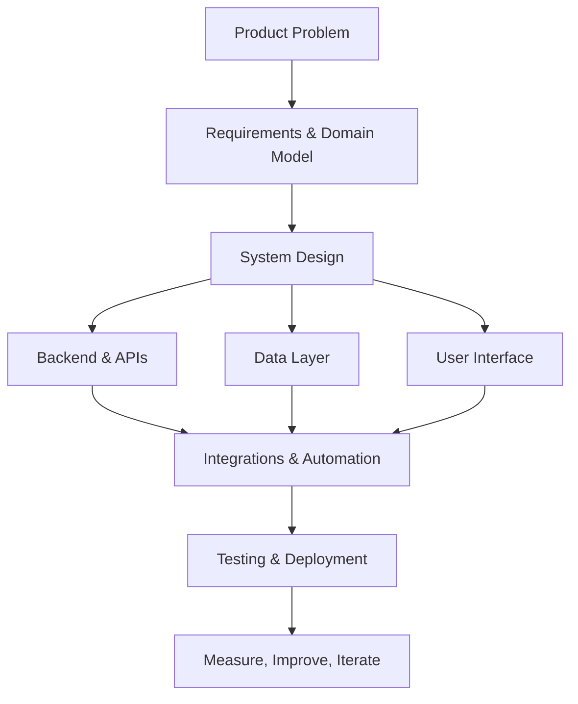

# Leo S. 👋

### Full-Stack Engineer · Product Development · AI Integration

I build practical software products end to end — from backend services, APIs, and data models to user interfaces, integrations, and deployment.

My work spans PHP and Go backends, modern JavaScript frontends, automation, and LLM-powered features. I enjoy taking a problem from an initial idea to a working product, as well as improving and extending existing systems.

---

## Engineering Profile

| Area | Focus |
|---|---|
| **Product Engineering** | Independent SaaS products, web applications, API-first systems |
| **Backend Development** | PHP, Laravel, Symfony, Go, REST APIs, authentication, background jobs |
| **Frontend Development** | JavaScript, TypeScript, Vue, React, responsive interfaces |
| **Data & Integrations** | PostgreSQL, MySQL, Redis, SQL, external APIs, webhooks, data collectors |
| **Automation & AI** | LLM API integration, OpenAI, Claude, LangChain, workflow automation |
| **Delivery** | Docker, Linux, CI/CD, testing, application deployment |

## Selected Projects

### [Weal Profile](https://github.com/Leouix/weal-profile)
**WordPress plugin · PHP · GPL-2.0-or-later**

A front-end profile and community-engagement plugin for WordPress. It adds editable user profiles, avatar management, comment likes and dislikes, post ratings, activity tracking, and configurable achievement badges. The plugin is translation-ready and published in the official WordPress Plugin Directory.

[WordPress Plugin](https://wordpress.org/plugins/weal-profile) · [Project Website](https://weal-profile.com)

### [Calender](https://github.com/Leouix/calender)
**Financial events calendar · Python · Laravel · Vue 3**

A financial calendar for corporate events such as dividends, financial reports, and shareholder meetings.

- A Python collector gathers event data from external providers.
- A Laravel REST API serves companies and calendar events.
- A Vue 3 interface renders events with FullCalendar and filtering by ticker and event type.
- MySQL and Redis support the application stack.

### [Crypto Watcher](https://github.com/Leouix/crypto-watcher)
**Ethereum monitoring service · Go**

A backend service for tracking Ethereum addresses and notifying users about relevant transactions.

- Indexes new Ethereum blocks and tracks incoming and outgoing transactions.
- Reads native ETH and ERC-20 balances through Ethereum RPC.
- Uses configurable threshold-based alerts and outgoing webhooks.
- Includes JWT authentication, asynchronous worker processing, and SQL code generation with `sqlc`.

### [Book Library API](https://github.com/Leouix/book-library)
**REST API · Go · PostgreSQL**

A backend for uploading and managing a digital book library. It includes authentication, database migrations, generated SQL models, asynchronous file processing, and cloud file storage.

### [Calendar API](https://github.com/Leouix/calendar-api)
**Laravel · PHP**

A Laravel backend project with application, database, routing, frontend asset, and test structure.

---

## Technical Stack

### Languages

`PHP` · `Go` · `Python` · `JavaScript` · `TypeScript` · `SQL`

### Backend & APIs

`Laravel` · `Symfony` · `REST` · `JWT` · `Webhooks` · `Background Workers` · `sqlc`

### Frontend

`Vue 3` · `React` · `Vite` · `FullCalendar` · `HTML` · `CSS`

### Databases & Infrastructure

`PostgreSQL` · `MySQL` · `Redis` · `Docker` · `Linux` · `CI/CD`

### AI & Automation

`OpenAI API` · `Claude` · `LangChain` · `LLM Integration` · `Workflow Automation`

---

## How I Approach Engineering

I prefer to understand the product and its data flow before choosing implementation details. The goal is to keep the system understandable, testable, and straightforward to operate.

## Engineering Principles

| Principle | What it means in practice |
|---|---|
| **Useful over complicated** | Choose the simplest architecture that solves the actual problem. |
| **Clear boundaries** | Keep business logic, API contracts, persistence, and UI responsibilities understandable. |
| **Automation** | Automate repeatable work and use integrations where they remove manual effort. |
| **Maintainability** | Treat documentation, tests, migrations, and deployment as part of the product. |
| **Continuous learning** | Explore new tools and approaches, while keeping the production solution practical. |

## Current Interests

- Building independent SaaS products and developer tools.
- Designing reliable APIs and integrations between services.
- Applying LLMs to useful product features and development workflows.
- Improving data collection, analysis, and automation pipelines.
- Contributing to open-source projects and learning from established codebases.

## Connect

- **GitHub:** [@Leouix](https://github.com/Leouix)
- **WordPress.org:** [@leouix](https://profiles.wordpress.org/leouix/)
- **Website:** [ProLeadly](https://proleadly.com)
- **Telegram:** [@leouix](https://t.me/leouix)

---

*I like building software that solves real problems — and making the systems behind it simple enough to evolve.*
